# ERD database POS — DB-02 (draf review)

Sumber fisik: [pos-schema.sql](pos-schema.sql). Status, keputusan teknis dan batas
penegakan: [database-review.md](database-review.md). Draf seluruh sistem, bukan
skema produksi yang telah disahkan. Tidak ada relasi kepemilikan permanen antara
pelanggan dan kendaraan; hubungan berasal dari kunjungan.

Diagram dipisah per modul agar terbaca. Atribut lengkap hanya ditampilkan pada
modul pemilik tabel; entitas luar muncul sebagai referensi. Semua FK fisik,
termasuk FK komposit dan pointer revisi, ditampilkan. Label relasi menyebut kolom
anak. Kardinalitas diturunkan dari nullability dan kunci unik SQL, bukan jaminan
jumlah minimum baris lintas tabel. Minimum satu revisi/Teknisi tertentu tetap
invariant transaksi server. Relasi polimorfik paket dan audit tidak memiliki FK
fisik; jangan menganggapnya telah ditegakkan database.

## Access

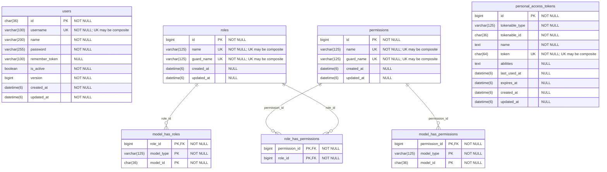

## Visits

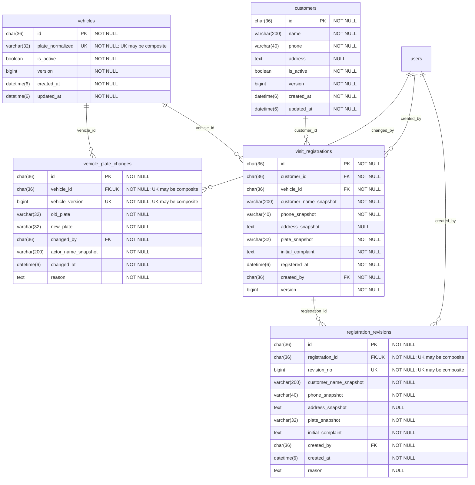

## Catalog

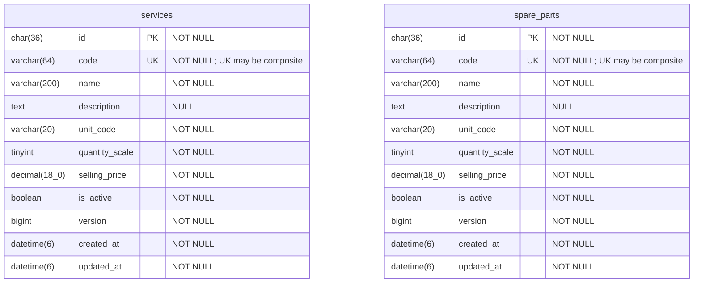

## Diagnosis

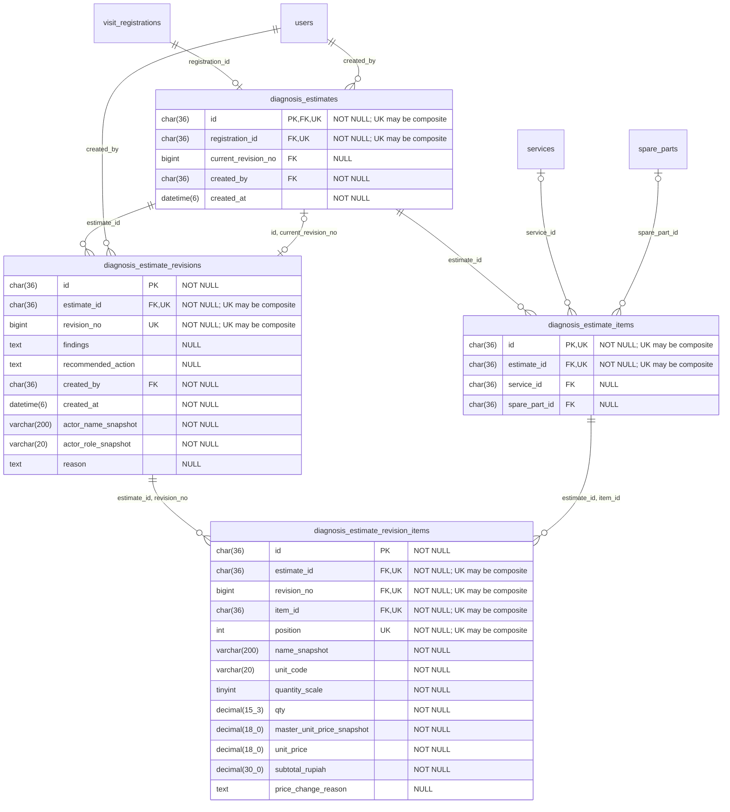

## Service

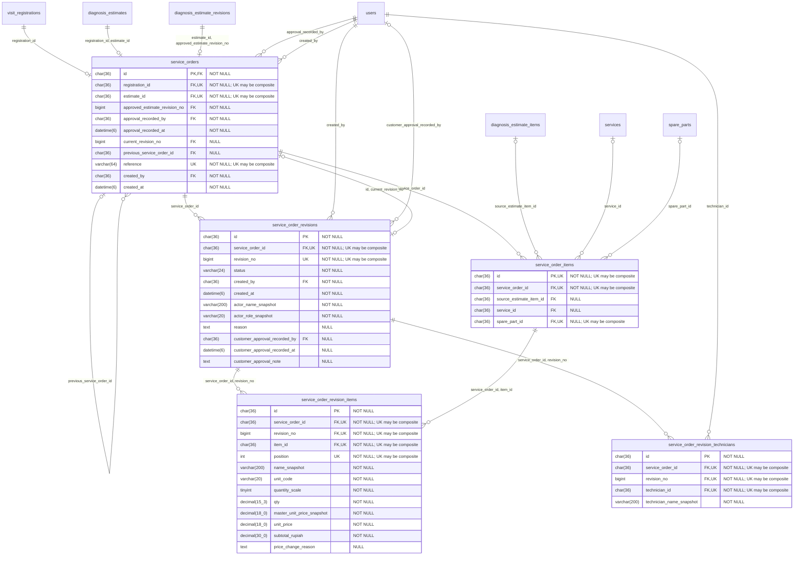

## Billing

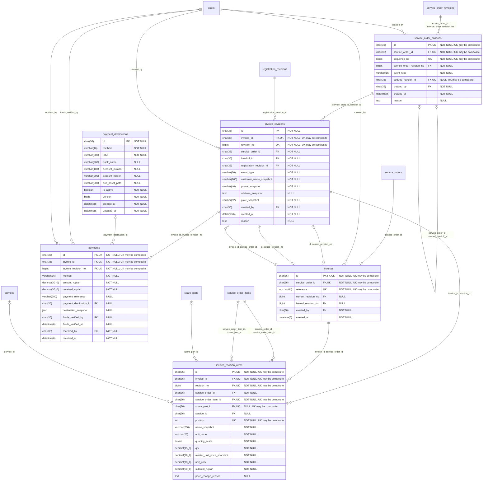

## Purchasing

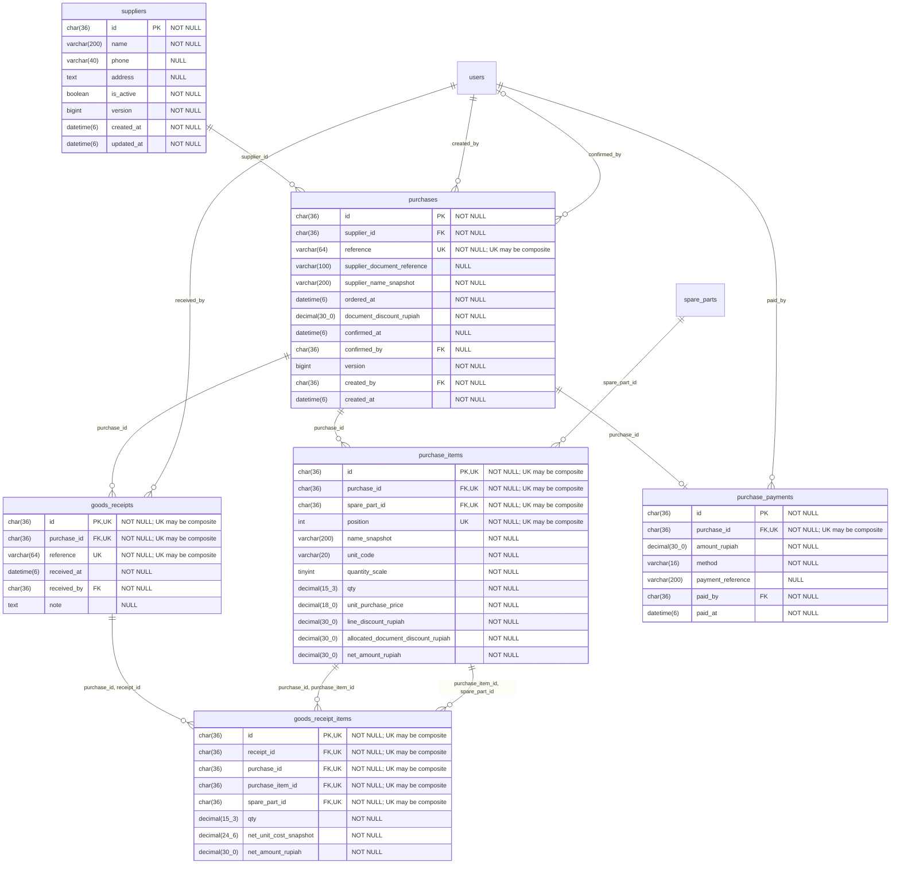

## SupplierReturns

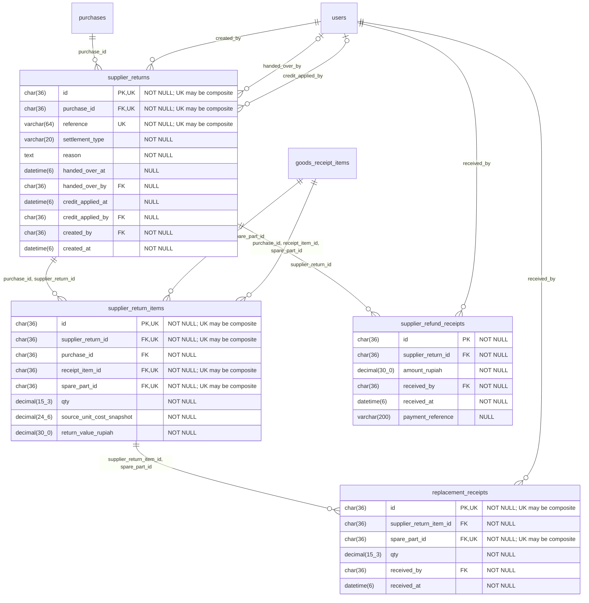

## CustomerReturns

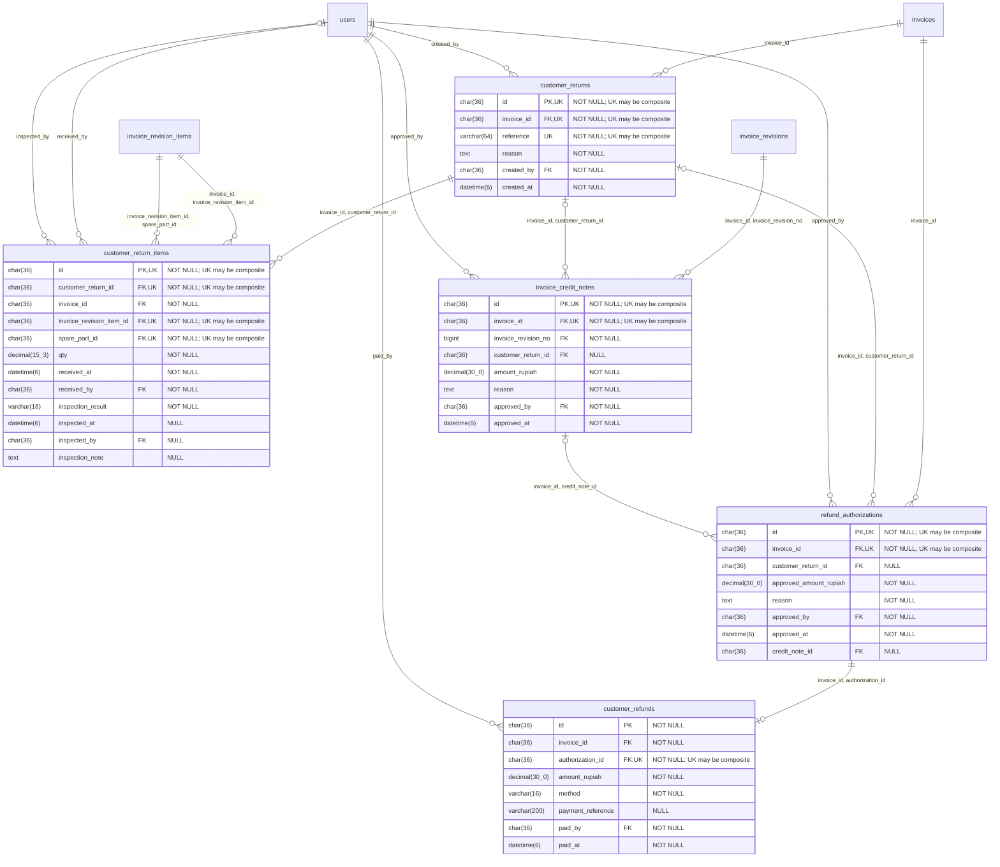

## Stock

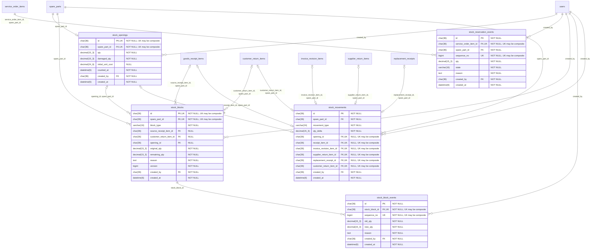

## Operations

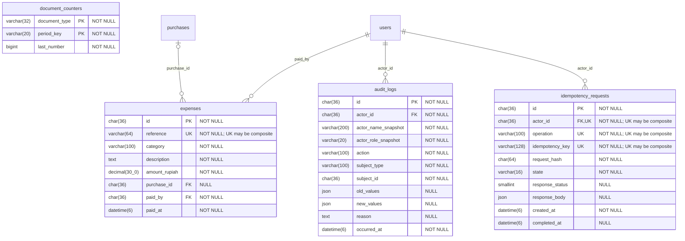

## Proyeksi, bukan tabel transaksi tambahan

- `v_current_stock_reservations`: event reservasi terakhir per baris SO.
- `v_stock_quantities`: stok tercatat, reservasi, blokir dan stok tersedia.
- `v_invoice_balances`: total revisi aktif, kredit, pembayaran, refund dan saldo.
- `v_supplier_balances`: nilai pembelian, pengurangan utang, pembayaran dan sisa.

Dashboard, laporan dan pencarian global membaca data tersebut/dokumen sumber;
tidak membuat tabel saldo laporan atau tabel riwayat pelanggan kedua.
